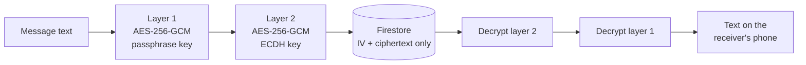
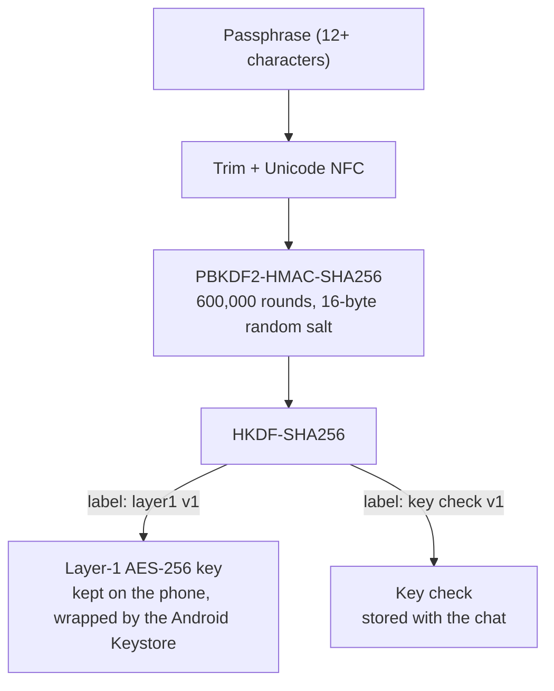
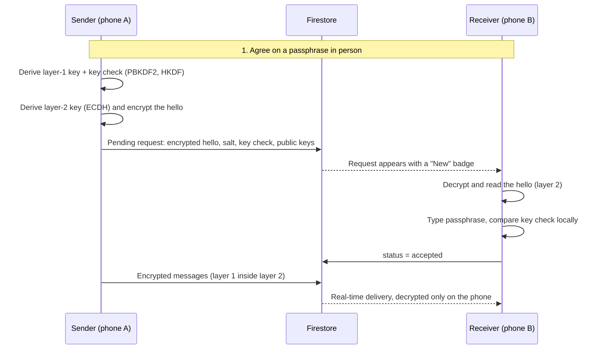

# SecureChat

**A privacy-focused Android messenger where the server never sees your messages.**

SecureChat encrypts every message twice on your phone before it is uploaded:

- The first layer uses a passphrase you and your friend agree on **in person**.
- The second layer uses a key your two phones work out on their own with ECDH.

The cloud database (Firebase Cloud Firestore) only ever stores ciphertext. Its security rules refuse anything that isn't encrypted, even from a modified app.

> Built as a university project: *Privacy-Focused Messaging App*.

---

## Contents

- [Features](#features)
- [How the encryption works](#how-the-encryption-works)
- [Getting started](#getting-started)
- [How to use the app](#how-to-use-the-app)
- [Establishing a chat, step by step](#establishing-a-chat-step-by-step)
- [Project structure](#project-structure)
- [Data model](#data-model)
- [Security model](#security-model)
- [Building a release APK](#building-a-release-apk)
- [Push notifications (optional)](#push-notifications-optional)
- [Troubleshooting](#troubleshooting)
- [Known limitations](#known-limitations)
- [Roadmap](#roadmap)
- [Tech stack](#tech-stack)
- [License](#license)

---

## Features

### Privacy and security
- **Two-layer end-to-end encryption.** AES-256-GCM with a passphrase key, inside AES-256-GCM with an ECDH key.
- **Passphrase agreed in person.** A chat can't start until both people type the same passphrase. This also guards against a server quietly swapping public keys.
- **The passphrase is never sent or stored.** The receiver's phone checks it locally against a *key check* value.
- **Slow to guess on purpose.** PBKDF2-HMAC-SHA256 with 600,000 rounds and a random salt for every chat.
- **Tamper detection.** Each layer is bound to the chat ID and sender ID, so a changed, moved or relabelled message is refused.
- **Chat keys protected on the phone** by a key inside the Android Keystore that cannot be exported.
- **Server-enforced rules.** Messages may contain only `senderId`, `iv`, `ciphertext` and `createdAt`, and only in accepted chats.
- **Private notifications.** They say "New encrypted message" and never show the text or the sender.

### Messaging
- Real-time one-to-one chat.
- Chat requests with a short hello that the receiver can read before accepting.
- Chat list sorted by latest message, with unread counts.
- Read ticks: 🕓 sending, ✓ sent, ✓✓ seen.
- "Today" and "Yesterday" dividers, with a time on every message.
- Long-press a message to copy it or *delete for me*.
- Delete a whole chat for both people.
- Block and unblock users, enforced by the server.
- Chat history comes back on a new phone after you log in and re-enter each passphrase.

### Account and app
- Email and password login, *Forgot password?*, and change password.
- Show/hide (eye) button on every password and passphrase field.
- Search for people by any part of their email address or display name.
- Display names, and light, dark or system theme.
- Material 3 design, edge-to-edge layout, custom adaptive app icon.
- Survives screen rotation (ViewModels).

---

## How the encryption works



### Layer 1: the passphrase key (agreed in person)



- The **salt** and **key check** are stored in the chat document. Neither reveals the key.
- The receiver repeats the derivation and compares key checks in **constant time**. A wrong passphrase is refused on the phone and nothing is sent.
- Unicode normalisation means the same passphrase, including Bangla text, gives the same key on any keyboard.

### Layer 2: the per-pair ECDH key (automatic)

- On first login each user gets a **P-256 key pair**. The public key goes into their profile. The key pair is kept in `users/{uid}/private/identity`, a document only its owner can read, so history can be recovered on a new phone.
- For each chat, both phones compute `ECDH(my private key, their public key)`, then HKDF salted with the **chat ID**. Both arrive at the same AES-256 key without ever sending it.
- The chat request's hello uses **layer 2 only**, so the receiver can read who is asking before typing the passphrase.

### Associated data (AAD)

Every encryption is bound to its context:

```
SecureChat|L1|<chatId>|<senderId>     inner layer
SecureChat|L2|<chatId>|<senderId>     outer layer
SecureChat|REQ|<chatId>|<requesterId> request hello
```

If any of these values changes, GCM authentication fails and the app shows *"Couldn't decrypt this message"* instead of corrupted text.

---

## Getting started

### Requirements

| Item | Version |
|---|---|
| Android Studio | Recent stable release |
| Android SDK | compileSdk / targetSdk 37 |
| Minimum Android | 7.0 (API 24) |
| JDK | The one bundled with Android Studio |
| Firebase | A project on the free Spark plan (Blaze only for notifications) |

### 1. Clone the repository

```bash
git clone https://github.com/<your-username>/SecureChat.git
cd SecureChat
```

### 2. Create a Firebase project

1. Go to the [Firebase console](https://console.firebase.google.com/) and create a project.
2. Add an **Android app** with the package name `com.example.securechat`.
3. Download **`google-services.json`** and put it in the `app/` folder.
4. Turn on **Authentication → Sign-in method → Email/Password**.
5. Create a **Cloud Firestore** database. The original uses `asia-south1` (Mumbai); pick the region closest to your users.

> `google-services.json` only identifies your Firebase project. It holds no secret, and all access is still checked by the security rules. Many people still keep it out of public repositories; see [`.gitignore`](#recommended-gitignore).

### 3. Deploy the security rules

Copy `firestore.rules` into **Firestore → Rules** in the console and click **Publish**. If you use the Firebase CLI:

```bash
firebase deploy --only firestore:rules
```

> ⚠️ **Don't skip this step.** Without these rules, the database would be open, and the server would not reject unencrypted messages.

### 4. Build and run

1. Open the project in Android Studio and let Gradle sync.
2. Start an emulator, or connect a phone with USB debugging turned on.
3. Press **Run ▶**.

To test a chat you need **two accounts**. Use two emulators, or an emulator and a phone.

---

## How to use the app

### Create an account
1. Open SecureChat and tap **Create account**.
2. Enter your email and a password of at least 8 characters, then confirm it.
3. The app sets up your encryption keys automatically ("Setting up encryption…"). This needs an internet connection the first time.

### Set your display name (optional)
Tap the **⚙ gear icon → Display name**, so friends see your name instead of your email.

### Forgot your password?
On the login screen tap **Forgot password?** and enter your email. You'll get a reset link. The app shows the same message whether or not the email is registered, so nobody can use it to check who has an account.

> Resetting your password does **not** affect your chats. Encryption keys are completely separate from your account password.

---

## Establishing a chat, step by step



### 1. Agree on a passphrase in person
Meet your friend, or talk somewhere private, and choose a passphrase of **at least 12 characters**. A few random words work well:

```
mango river seven lantern
```

**Never** send the passphrase by message, email or any other app. It is the one secret the server never learns.

### 2. Send a chat request
1. On the chat list, tap **New chat**.
2. Type at least 3 letters of your friend's name or email and select them.
3. Write a short hello (up to 300 characters), such as *"Hi, it's Akib from class!"*
4. Type the passphrase **twice** and tap **Send request**.

The app needs about a second to stretch the passphrase. This is deliberate: it slows down anyone trying to guess it.

### 3. Accept the request (your friend)
1. Your friend sees your request at the top of their chat list with a **New** badge.
2. They open it and read your hello.
3. They type the **same passphrase** and tap **Accept**.
   - Right passphrase: the chat opens.
   - Wrong passphrase: *"Wrong key"*. Nothing is sent to the server, and they can try again.
   - Not interested: they tap **Decline**, which deletes the request.

The sender can cancel a request while it is still pending.

### 4. Chat
- Messages arrive in real time.
- 🕓 sending · ✓ sent · ✓✓ seen
- **Long-press** a message to *Copy* or *Delete for me* (hidden on your phone only).
- Use the **⋮ menu** to *Delete chat* (for both people) or *Block*.

### 5. On a new phone
Log in with the same account. Your key pair is restored automatically. Open each chat and type its passphrase **once**, and the history decrypts again.

---

## Project structure

```
app/src/main/java/com/example/securechat/
├── MainActivity.kt            Entry point, edge-to-edge, notification permission
├── SecureChatApp.kt           Navigation between screens
├── auth/
│   └── AuthRepository.kt      Login, register, reset/change password, profile
├── crypto/
│   ├── ChatCrypto.kt          Two-layer encrypt/decrypt, request hello
│   ├── MessageEncryption.kt   One AES-256-GCM layer (random IV, AAD)
│   ├── PassphraseKeys.kt      NFC, PBKDF2-HMAC-SHA256 (hand-written for API 24), key check
│   ├── Hkdf.kt                HKDF-SHA256 (RFC 5869)
│   ├── IdentityKeys.kt        P-256 key pair and ECDH layer-2 key
│   ├── LocalKeyStore.kt       Layer-1 keys wrapped by the Android Keystore
│   └── Codec.kt               Base64 that works on API 24
├── data/
│   ├── ChatRepository.kt      Users, chats, requests, messages, blocking
│   ├── IdentityRepository.kt  Loads or creates the key pair (never replaces it)
│   ├── HiddenMessages.kt      "Delete for me"
│   └── TaskAwait.kt           Firebase Task → coroutine helper
├── model/                     ChatInfo, ChatUser, StoredMessage, ChatMessage
├── push/                      PushService, PushTokens, Notifications
├── settings/AppSettings.kt    Theme preference
├── viewmodel/
│   ├── AppViewModel.kt        Signed-in session, chat list, blocked users
│   └── ChatViewModel.kt       One open chat, decryption off the main thread
└── ui/
    ├── AuthScreen.kt  SetupScreen.kt  HomeScreen.kt  NewChatScreen.kt
    ├── RequestScreen.kt  KeyEntryScreen.kt  ChatScreen.kt  SettingsScreen.kt
    ├── components/            Bubbles, dialogs, password field, avatars, icons
    └── theme/                 Colours, typography, light/dark theme

firestore.rules                Server-side security rules
functions/index.js             Cloud Function for push notifications
```

---

## Data model

| Path | Main fields | Who can read |
|---|---|---|
| `users/{uid}` | uid, email, displayName, publicKey, createdAt | Any signed-in user (needed for search) |
| `users/{uid}/private/identity` | publicKey, privateKey, createdAt | Owner only; created once, never replaced |
| `users/{uid}/private/fcm` | tokens (max 20), updatedAt | Owner only |
| `users/{uid}/blocked/{otherUid}` | createdAt | Owner only |
| `chats/{chatId}` | requesterId, recipientId, status, requestIv, requestCiphertext, kdfSalt, keyCheck, both public keys, lastMessageAt, unread_{uid}, readAt_{uid} | The two participants |
| `chats/{chatId}/messages/{id}` | senderId, iv, ciphertext, createdAt | The two participants |

`chatId` is the two UIDs, sorted and joined with `_`, so both phones compute it without asking the server.

**There is no field for message text and no field for the passphrase.**

---

## Security model

| Who is trying to read your messages | Result |
|---|---|
| Someone on the same Wi-Fi | Blocked by HTTPS **and** the encryption |
| Someone who copies the database | Sees only ciphertext |
| Another registered user | Blocked by the rules **and** the encryption |
| The Firebase project owner | Can't read messages without the in-person passphrase |
| Someone holding your unlocked phone | Can read; use a screen lock |

### What the server *can* see (metadata)
- Who chats with whom, when messages are sent, roughly how long they are, and read times.
- Email addresses and display names (needed for search).
- Each user's key pair. The layer-2 private key is stored in an owner-only document. Whoever controls the Firebase project could read it, and that is exactly why layer 1 exists: without the passphrase, messages stay locked.

### Account security
- Passwords are handled entirely by **Firebase Authentication**, which stores only a salted, modified-scrypt hash. SecureChat never stores your password anywhere.
- The account password is **not** used for any encryption key.

> SecureChat is a student project and has **not** been independently audited. Don't rely on it where your safety depends on it; use an established app such as Signal.

---

## Building a release APK

1. Create a signing key **outside** the project folder (once):

   ```bash
   keytool -genkeypair -v -storetype JKS -keystore securechat-release.jks \
     -alias securechat -keyalg RSA -keysize 2048 -validity 10000
   ```

2. In Android Studio: **Build → Generate Signed App Bundle or APK → APK → Choose existing**. Select the key, choose **release**, then **Create**.
3. The APK appears in `app/release/`.

> 🔐 Back up the `.jks` file and its passwords. Without them you can never publish an update. **Never commit them to Git.**

The release optimizer (R8) is currently **disabled** in `app/build.gradle.kts`, because it removed code needed at start-up:

```kotlin
buildTypes {
    release {
        optimization { enable = false }
    }
}
```

---

## Push notifications (optional)

The app side is complete. Sending notifications needs a Cloud Function, which requires Firebase's **Blaze (pay-as-you-go)** plan.

```bash
npm install -g firebase-tools
firebase login
firebase init functions      # choose JavaScript, then use functions/index.js from this repo
firebase deploy --only functions
```

The function sends only `{ type, chatId }`. The phone then shows a generic "New encrypted message" or "New chat request". On Android 13 and newer, the app asks for notification permission on first launch.

---

## Troubleshooting

| Problem | Fix |
|---|---|
| `PERMISSION_DENIED` when sending a request | Publish the latest `firestore.rules`. Delete old chat documents left over from earlier versions |
| "*Name* hasn't set up encryption yet" | That user must log in once with the current app so their public key is created |
| "Connect to the internet to finish setting up encryption" | The first login needs a connection to load or create your key pair |
| "Wrong key" | The passphrase must match exactly. Spaces at the start and end are ignored, but capital letters matter |
| "Couldn't decrypt this message" | The message was changed, or this chat was set up with a different key pair |
| Release APK closes immediately | Keep R8 optimisation disabled (see above) |
| No notifications | Deploy the Cloud Function (Blaze plan) and allow notifications on the phone |
| Emulator shows a black screen | Cold-boot the emulator or open it in its own window; check Logcat to confirm the app is running |

---

## Known limitations

- **No forward secrecy.** Each chat keeps the same keys.
- The **layer-2 private key is stored on the server** (owner-only), so layer 1 carries the protection against the project owner.
- **Profiles are readable by all signed-in users** so that search works.
- **Email addresses are not verified.**
- **Metadata is visible** to the server.
- Text only: no groups, photos or calls yet.
- A brief **typing lag** in long chats (a fix is in progress).

## Roadmap

- [ ] Fix typing lag in long chats
- [ ] Deploy notification function
- [ ] Re-enable R8 with proper keep rules
- [ ] Email verification
- [ ] Firebase App Check
- [ ] Private, server-side user search
- [ ] Forward secrecy (key rotation)
- [ ] Encrypted photos and files
- [ ] Group chats
- [ ] Optional screenshot blocking and app lock
- [ ] Automated UI tests

---

## Tech stack

| Area | Technology |
|---|---|
| Language | Kotlin |
| UI | Jetpack Compose, Material 3 |
| Architecture | Repositories + AndroidX ViewModel |
| Auth | Firebase Authentication (email/password) |
| Database | Cloud Firestore + Security Rules |
| Push | Firebase Cloud Messaging + Cloud Functions (Node.js) |
| Crypto | Java Cryptography Architecture: AES-256-GCM, ECDH P-256, HMAC-SHA256, PBKDF2, HKDF |
| Key storage | Android Keystore |

---

## Recommended `.gitignore`

```gitignore
# Signing keys: never commit
*.jks
*.keystore
keystore.properties

# Firebase config (optional to hide)
app/google-services.json

# Build output
/build
/app/build
/app/release
.gradle/
local.properties
.idea/
*.iml
```

---


## Author

**Md. Sazidur Rahman**: university project, *Privacy-Focused Messaging App*.

Contributions, issues and suggestions are welcome.
